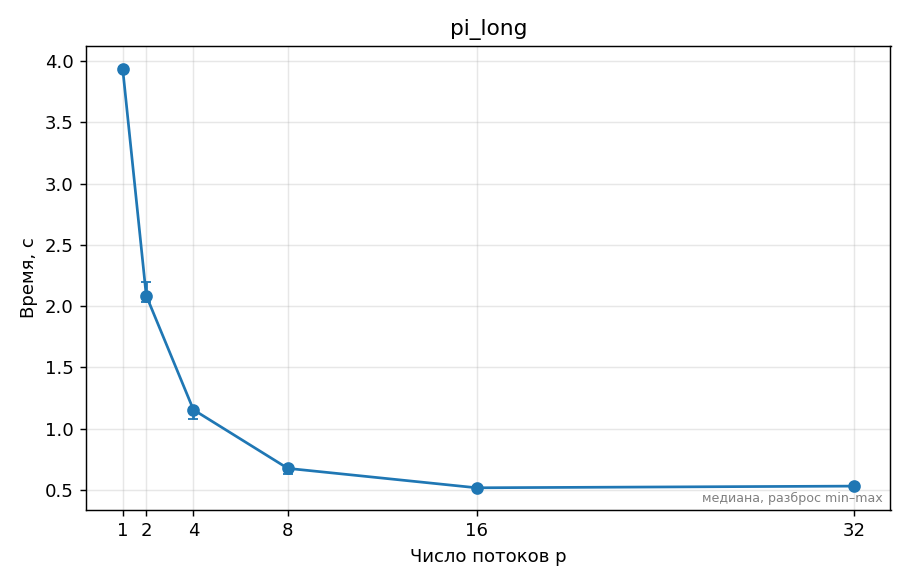
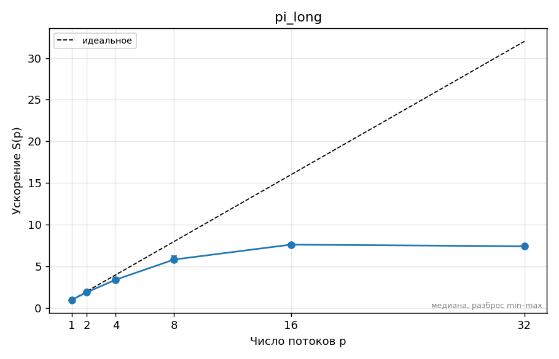
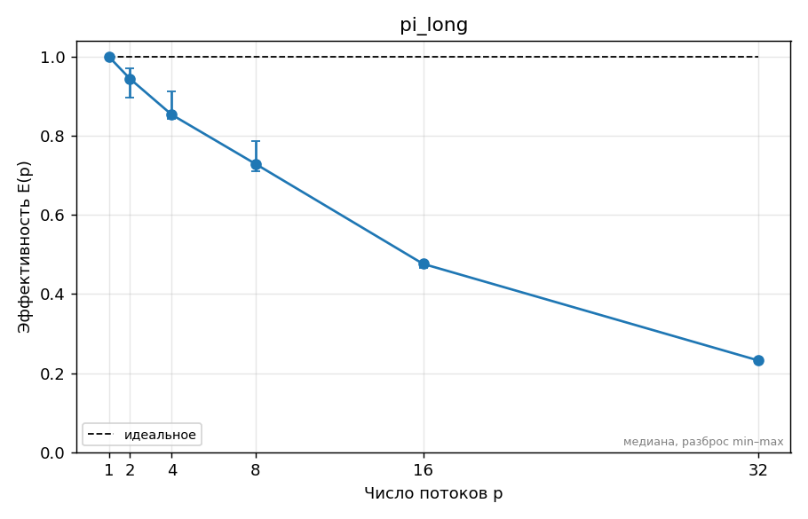

<!--  ← удалите эту строку, когда отчёт готов к сдаче (иначе CI его не проверяет) -->
# ДЗ 0. Окружение и паспорт стенда — Назаров Андрей, вариант 11

## 1. Прогноз

<!-- Заполните и ЗАКОММИТЬТЕ этот раздел ДО запуска замеров (отдельным коммитом «Прогноз»).
     Неверный прогноз не штрафуется; штрафуется отсутствие объяснения расхождения в разделе 5.
     Отвечайте числами: «ускорение на 4 потоках ≈ 3,2, потому что …», «schedule(static) проиграет
     dynamic в ≈1,5 раза, потому что …». -->
1. ускорение на 2 потоках = 1.97, потому что накладные расходы OpenMP.
   ускорение на 4 потоках = 3.8, потому что турбо-частота падает с ростом числа активных ядер.
   ускорение на 8 потоках = 7.1, потому что турбо-частота падает под полной нагрузкой и из-за фоновых процессов.
   ускорение на 16 потоках = 9.87, потому что SMT.
2. ускорение на 32 потоках = 9.8 потому что накладные расходы на переключение потоков.
3. Е-ядер нет, поэтому ничего не ожидаю, но если бы были, то излом на 8 потоках на графике, потому что SMT почти не помогает, а частота на E-ядрах падает. 

## 2. Стенд

<!-- Ссылка на ../SYSTEM.md и то, что важно именно для этого ДЗ: число физических ядер,
     P/E-ядра, объём L3, питание от сети, режим производительности, версия компилятора и флаги. -->
[SYSTEM.md](../SYSTEM.md) 8 физ ядер, P/E-ядра отсутствуют, 32 МиБ L3, питание от сети, режим - оптимальная производительность, версия 15.2.0, флаги '-O2 -std=c11 -Wall -Wextra -fopenmp', '_OPENMP' = 201511
## 3. Методика

<!-- Какие программы и с какими параметрами запускались, сколько повторов, как получено
     итоговое число (медиана), переменные OMP_* (OMP_PROC_BIND, OMP_PLACES, OMP_SCHEDULE…),
     точные команды bench.py/plot.py (или «make bench plots»). Как проверялась корректность. -->
1. программа pi (интеграл методом средних прямоугольников), n = 4·10⁹ для основного замера (4·10⁸ для короткого), потоки 1, 2, 4, 8, 16, 32.
2. 5 повторов каждой конфигурации + прогревочный запуск.
3. медиана из 5 повторов.
4. Не задавались.
5. `python3 ../tools/bench.py --cmd "./build/pi {n}" --threads 1,2,4,8,16,32 --set n=4000000000 --repeat 5 --warmup 1 --out results/pi_long.csv`
`python3 ../tools/plot.py results/pi_long.csv --kind speedup --table` (аналогично `--kind time` и `--kind efficiency` с `--out plots/pi_long_*.png`)
6. make test, make tsan.
## 4. Результаты

<!-- Таблицы (python3 ../tools/plot.py results/….csv --table) и графики из plots/.
     Каждый график — с подписью: что на нём и какой вывод из него следует.
     Пример вставки:  -->

## 5. Объяснение расхождений с прогнозом

<!-- Для каждого пункта прогноза: подтвердился или нет, почему. Привязывайтесь к конкретным
     точкам: «на 6 потоках ускорение упало с 3,4 до 3,1, потому что …». Минимум две
     «неочевидные» точки графика объяснить обязательно. -->
1. 2 потока: 1.89 вместо 1.97, подтвердился, я переоценил ускорение.
2. 4 потока 3.41 вместо 3.8, не подтвердилось, видимо сказались какие-то фоновые процессы и шум или замедление турбо частоты оказалось слишком сильным.
3. 8 потоков 5.83 вместо 7.1, не подтвердилось, скорее всего то же самое, что и с 4 потоками + не выдавались все физические ядра для стабильной работы пк
4. 16 потоков 7.62 вместо 9.87, не подтвердилось, но по сути это примерно такой же прирост относительно 8 потоков, как и в прогнозе.
5. 32 потока 7.42 вместо 9.8, не подтвердилось, но по сути упало на примерно на столько же скорее всего по тем же причина, что и в прогнозе.
## 6. Выводы

<!-- 3–5 пунктов: что вы теперь знаете о своей машине и о задаче, что бы сделали дальше. -->
1. SMT даёт прирост в районе 30%
2. Изначальная длина прогона была слишком короткой, и результат искажался стартом потоков, поэтому пришлось её увеличивать
3. Я бы проверил на чистом линуксе, винда -- зло, но такое удобное...
4. Скорее всего, я переоценил ресурсы, выдаваемые программе.

