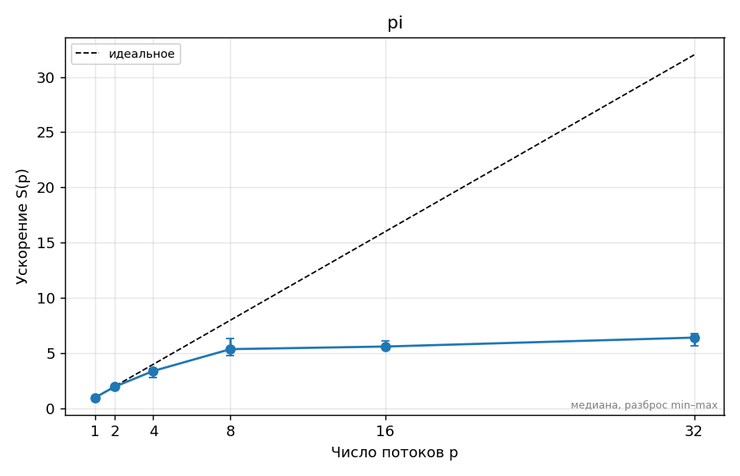

git add hw0/REPORT.md
git commit -m "ДЗ0: прогноз"
git push<!-- template:unfilled  ← удалите эту строку, когда отчёт готов к сдаче (иначе CI его не проверяет) -->
# ДЗ 0. Окружение и паспорт стенда — Назаров Андрей, вариант 11

## 1. Прогноз

<!-- Заполните и ЗАКОММИТЬТЕ этот раздел ДО запуска замеров (отдельным коммитом «Прогноз»).
     Неверный прогноз не штрафуется; штрафуется отсутствие объяснения расхождения в разделе 5.
     Отвечайте числами: «ускорение на 4 потоках ≈ 3,2, потому что …», «schedule(static) проиграет
     dynamic в ≈1,5 раза, потому что …». -->
1. ускорение на 2 потоках = 1.97, потому что накладные расходы OpenMP.
   ускорение на 4 потоках = 3.8, потому что турбо-частота падает с ростом числа активных ядер.
   ускорение на 8 потоках = 7.1, потому что турбо-частота падает под полной нагрузкой и из-за фоновых процессов.
   ускорение на 16 потоках = 9.87, потому что SMT.
2. ускорение на 32 потоках = 9.8 потому что накладные расходы на переключение потоков.
3. Е-ядер нет, поэтому ничего не ожидаю, но если бы были, то излом на 8 потоках на графике, потому что SMT почти не помогает, а частота на E-ядрах падает. 

## 2. Стенд

<!-- Ссылка на ../SYSTEM.md и то, что важно именно для этого ДЗ: число физических ядер,
     P/E-ядра, объём L3, питание от сети, режим производительности, версия компилятора и флаги. -->

## 3. Методика

<!-- Какие программы и с какими параметрами запускались, сколько повторов, как получено
     итоговое число (медиана), переменные OMP_* (OMP_PROC_BIND, OMP_PLACES, OMP_SCHEDULE…),
     точные команды bench.py/plot.py (или «make bench plots»). Как проверялась корректность. -->

## 4. Результаты

<!-- Таблицы (python3 ../tools/plot.py results/….csv --table) и графики из plots/.
     Каждый график — с подписью: что на нём и какой вывод из него следует.
     Пример вставки:  -->

## 5. Объяснение расхождений с прогнозом

<!-- Для каждого пункта прогноза: подтвердился или нет, почему. Привязывайтесь к конкретным
     точкам: «на 6 потоках ускорение упало с 3,4 до 3,1, потому что …». Минимум две
     «неочевидные» точки графика объяснить обязательно. -->

## 6. Выводы

<!-- 3–5 пунктов: что вы теперь знаете о своей машине и о задаче, что бы сделали дальше. 
